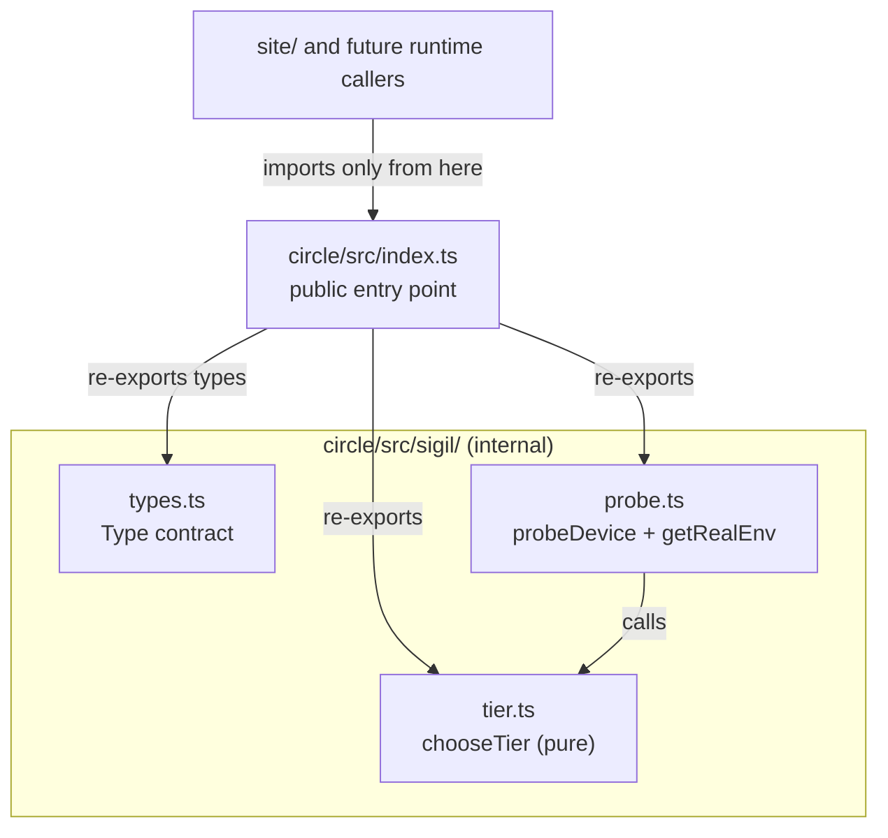
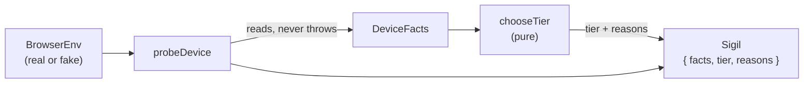

# Design Document: Device Sigil

## Overview

The device sigil is the first piece of the Summoning Circle runtime (`circle/`). Before the runtime downloads any model, it must know what the host device can run. The sigil probes the browser once and answers two questions:

1. **What does this device have?** — WebGPU, a real (non-software) adapter, the largest GPU buffer the adapter allows, device memory, CPU cores, and free site storage.
2. **Which model size tier should the runtime use?** — `none`, `tiny`, `small`, or `full`.

Everything downstream in the runtime depends on this answer, so it is the right place to start. It is also self-contained and cheap to test: no AI models, no network, no workers — just browser APIs and pure logic.

Two functions carry the load, and the design rests on keeping them separate:

- **`chooseTier(facts)`** is a *pure* decision. The same `DeviceFacts` in always produce the same tier and reasons out. It never touches the browser, never awaits, and never throws. This makes it trivially testable in isolation and lets the property-based tests run against it directly.
- **`probeDevice(env?)`** *reads* the browser into a `Sigil`. It accepts an injectable `BrowserEnv` so tests can fake any device, and it is built around a never-throw guarantee: a missing or failing browser API becomes an `undefined` fact rather than a crash.

The separation is the central design idea. "What the device has" (probe, async, fallible, browser-bound) is decoupled from "what tier to pick" (pure, deterministic, logic-only). Each piece is simple on its own; together they form a probe whose result is fully explained and independently checkable.

### Scope

This spec covers only the sigil: the types, the two functions, and their tests. It does not download or run any model, build the worker pool, define the model registry, or change the landing page. The landing page has an earlier, simpler probe in `site/src/probe.ts`; this module replaces it later, not now.

## Architecture

The sigil lives in `circle/src/sigil/` and is exported through a single public entry point, `circle/src/index.ts`. Apps and the rest of the runtime import only from that entry point, never from the internal files.



The data flow through a single probe is linear:



`probeDevice` is the only boundary that touches the outside world. It reads the browser (or a fake), assembles `DeviceFacts`, hands those facts to the pure `chooseTier`, and packages both into a `Sigil`. Because `chooseTier` has no dependencies, it can be exercised exhaustively with generated inputs while `probeDevice`'s robustness is checked with a handful of fakes.

### The dependency-injection seam: `BrowserEnv`

`probeDevice` never reads `navigator` directly in a way tests cannot control. Instead, `getRealEnv()` builds a `BrowserEnv` from the real `navigator` once, wrapping each API in a try/catch so a missing API becomes `undefined` rather than throwing. When `probeDevice` is called with a `BrowserEnv` argument, it uses that one; when called with none, it uses `getRealEnv()`.

This seam is what makes the probe testable without a real browser. A test passes a fake `BrowserEnv` to simulate a gaming laptop, an old phone, a Safari-like browser that omits `deviceMemory`, or a hostile environment where every API throws. The real environment is never special-cased in the main body — it flows through the same code path as the fakes.

## Components and Interfaces

### `types.ts` — the type contract

This file holds every type other code and tests rely on. No runtime behavior lives here.

**`Tier`** — the model size class:
```ts
export type Tier = "none" | "tiny" | "small" | "full";
```
Ranked `none` < `tiny` < `small` < `full`. `none` means the device cannot run any model tier.

**`DeviceFacts`** — raw capabilities read from the browser. A field is `undefined` when the browser did not report it:
```ts
export type DeviceFacts = {
  webgpu: boolean;          // a real (not software) WebGPU adapter was found
  gpuName?: string;         // adapter description, when reported
  maxBufferMB?: number;     // largest GPU buffer the adapter allows, in MB
  memoryGB?: number;        // navigator.deviceMemory (Chrome-only, capped at 8)
  cores?: number;           // navigator.hardwareConcurrency
  freeStorageMB?: number;   // storage quota minus usage, in MB
};
```
The role of `undefined` is central: it is not "zero" and not "not enough". Each tier rule decides how to treat an unknown value (see Data Models → Unknown-value handling). Only `webgpu` is always a concrete boolean; every other field may be absent.

**`TierReason`** — a code explaining why a *higher* tier was not chosen:
```ts
export type TierReason =
  | "NO_WEBGPU"          // no adapter, or only a software fallback adapter
  | "LOW_MEMORY"
  | "LOW_STORAGE"
  | "SMALL_GPU_BUFFER"
  | "UNKNOWN_MEMORY";     // memory was unknown but the tier tolerates that
```
The reasons list describes what blocked a *higher* tier, not a general health report. For `full` it is always empty.

**`Sigil`** — the result of probing:
```ts
export type Sigil = {
  facts: DeviceFacts;
  tier: Tier;
  reasons: TierReason[];
};
```

**`BrowserEnv`** — the injectable bundle of browser APIs:
```ts
export type BrowserEnv = {
  requestAdapter?: () => Promise<{
    isFallbackAdapter?: boolean;
    info?: { description?: string };
    limits?: { maxBufferSize?: number | bigint };
  } | null>;
  deviceMemory?: number;
  hardwareConcurrency?: number;
  storageEstimate?: () => Promise<{ quota?: number; usage?: number }>;
};
```
Each member is optional; a member that is `undefined` means the browser did not expose that API, and the probe leaves the corresponding fact `undefined`.

### `tier.ts` — `chooseTier`

The pure decision function:

```ts
chooseTier(facts: DeviceFacts): { tier: Tier; reasons: TierReason[] }
```

It evaluates tiers from the top down; the first row whose requirements are all met wins. No browser access, no async, no side effects.

**Selection order:**

1. **`full`** — requires `webgpu` true, a *known* `memoryGB >= 8`, a *known* `freeStorageMB >= 4000`, and a *known* `maxBufferMB >= 1024`. Returns `{ tier: "full", reasons: [] }`. Unknown values count as "not enough" here, so a device with an unknown buffer cannot reach `full`.

2. **`small`** — requires `webgpu` true, `memoryGB` either `>= 4` or unknown, and a *known* `freeStorageMB >= 1000`. The `small` branch returns **exactly one** reason through a priority cascade:
   - if `memoryGB` is unknown → `["UNKNOWN_MEMORY"]`
   - else if `freeStorageMB < 4000` → `["LOW_STORAGE"]`
   - else if `maxBufferMB` is known and `< 1024` → `["SMALL_GPU_BUFFER"]`
   - else → `["LOW_STORAGE"]` (fallback)

   This is a deliberate implementation choice. It differs from the task brief's looser "add every matching reason" wording: the `small` tier always carries a single, most-salient reason. The two unit tests that pin `small` (U2: 8 GB / 1.5 GB storage → `["LOW_STORAGE"]`; U3: memory unknown → `["UNKNOWN_MEMORY"]`) both rely on this single-reason shape.

   A consequence of the cascade is the fallback `["LOW_STORAGE"]`: a device with WebGPU, known memory `>= 4`, storage `>= 4000`, but an *unknown* buffer lands in `small` with `["LOW_STORAGE"]` — because `full` was blocked by the unknown buffer, and the cascade's final arm defaults to storage. The reason is technically a misnomer in that specific corner (storage is not the actual limiter), but it keeps the invariant that every non-`full` tier reports at least one reason. This is documented as a known characteristic, not redesigned.

3. **`tiny`** — requires a *known* `freeStorageMB >= 200`. Runs on the CPU; WebGPU is not required. It *accumulates* multiple reasons:
   - `"NO_WEBGPU"` if `webgpu` is false
   - `"LOW_MEMORY"` if `memoryGB` is known and `< 4`
   - `"LOW_STORAGE"` if `freeStorageMB < 1000`
   - `"SMALL_GPU_BUFFER"` if `maxBufferMB` is known and `< 1024`
   - a defensive fallback pushes `["NO_WEBGPU"]` if no reason was added

   The fallback is effectively dead for reachable inputs: any `tiny` case with `webgpu` true and storage `>= 1000` and adequate memory would have been caught by `small`, so a zero-reason `tiny` does not occur in practice. It is kept as a guard so the function can never return an empty reasons list below `full`.

4. **`none`** — when `freeStorageMB` is unknown or `< 200`. It accumulates:
   - `"NO_WEBGPU"` if `webgpu` is false
   - `"UNKNOWN_MEMORY"` if `memoryGB` is unknown, else `"LOW_MEMORY"` if `memoryGB < 8`
   - always `"LOW_STORAGE"`

   So `none` always carries `LOW_STORAGE` plus a memory/webgpu reason.

### `probe.ts` — `probeDevice`

The async probe. It is built so it can never throw.

**`getRealEnv(): BrowserEnv`** — builds a `BrowserEnv` from the real `globalThis.navigator`:
- `requestAdapter` is `undefined` when `navigator.gpu` is absent; otherwise it is an async wrapper that `try/catches` `navigator.gpu.requestAdapter()` and returns `null` on error.
- `deviceMemory` and `hardwareConcurrency` are passed through directly (numbers or `undefined`).
- `storageEstimate` is `undefined` when `navigator.storage.estimate` is absent; otherwise an async wrapper that `try/catches` and returns `{}` on error.

Wrapping at the env-construction layer means the main body does not have to know whether an API exists — it just calls the function it was handed.

**`probeDevice(env?: BrowserEnv): Promise<Sigil>`** — the main body:
1. Resolves the environment: `const e = env ?? getRealEnv()`.
2. Reads the WebGPU adapter in its own `try/catch`. If `e.requestAdapter` is missing it reads `null`; otherwise it `await`s the adapter. A non-null adapter is checked for `isFallbackAdapter === true` — a fallback (software renderer) counts as no WebGPU, so `webgpu` stays `false` and `gpuName`/`maxBufferMB` stay `undefined`. For a real adapter it sets `webgpu = true`, reads `gpuName` from `adapter.info?.description` (staying `undefined` when absent), and converts `adapter.limits?.maxBufferSize` to MB only when it is present and not `null`: `maxBufferMB = Number(maxBufferSize) / (1024 * 1024)`. `Number()` coerces `bigint` values, which the WebGPU spec permits for limits.
3. Reads `deviceMemory` and `hardwareConcurrency` in their own `try/catch`, accepting each only when `typeof` it is `"number"` — so a non-numeric or missing value leaves the fact `undefined`.
4. Reads `storageEstimate` in its own `try/catch`, setting `freeStorageMB = (quota - usage) / (1024 * 1024)` only when both `quota` and `usage` are numbers.
5. Assembles `DeviceFacts`, calls `chooseTier(facts)`, and returns the `Sigil`.
6. An outer `try/catch` wraps the whole body. On any unexpected error it returns a minimal `Sigil` from `facts = { webgpu: false }` plus `chooseTier`'s result. This is the final guarantee that `probeDevice` never throws.

**Browser API verification.** Per the project rule (`local-ai.md`: never guess a browser API), the APIs the probe reads were checked against current official docs:

- **`navigator.gpu.requestAdapter()`** returns `Promise<GPUAdapter | null>` ([MDN: GPU.requestAdapter](https://developer.mozilla.org/en-US/docs/Web/API/GPU/requestAdapter)). The adapter exposes `info` (`GPUAdapterInfo`, whose `description` is a human-readable string or empty) and `limits` (`GPUSupportedLimits`, including `maxBufferSize`).
- **`isFallbackAdapter`** is the gotcha. It was originally a property on `GPUAdapter`; MDN now marks that property deprecated and removed from the web platform, directing callers to `GPUAdapterInfo.isFallbackAdapter` instead ([MDN: GPUAdapter](https://developer.mozilla.org/en-US/docs/Web/API/GPUAdapter)). The existing code reads `adapter.isFallbackAdapter`, the deprecated location. It still works in current Chrome (where the property is being removed over time), but this is a known fragility: as browsers move the property onto `adapter.info`, the fallback check could silently read `undefined` and treat a software adapter as a real one. This is recorded here as a known risk for a future task; the design does not change the existing code.
- **`navigator.deviceMemory`** is Chrome-only and deliberately coarse: it rounds actual memory to the nearest power of two and clamps it (commonly capping at 8). Safari and Firefox do not expose it, so `memoryGB` is `undefined` there ([MDN: Device Memory API](https://developer.mozilla.org/en-US/docs/Web/API/Device_Memory_API)). This is exactly why `small` must tolerate unknown memory.
- **`navigator.hardwareConcurrency`** returns the count of logical processors and is widely supported across modern browsers.
- **`navigator.storage.estimate()`** returns `{ quota, usage }`; free storage is `quota - usage`.

These are browser capabilities, not AI model libraries, so they are documented here rather than as model entries in `local-ai.md`; the model-entry section of that file is reserved for the per-part model verification that comes in later tasks.

### `index.ts` — the public entry point

The entire public surface:

```ts
export { probeDevice } from "./sigil/probe.js";
export { chooseTier } from "./sigil/tier.js";
export type { BrowserEnv, DeviceFacts, Sigil, Tier, TierReason } from "./sigil/types.js";
```

`probeDevice` and `chooseTier` are runtime-callable functions; the five types are type-only exports. Apps import only from this entry point and never from `circle/src/sigil/` internals, which is how the runtime proves its skeleton is reusable (Requirement 6).

## Data Models

### `DeviceFacts` fields and provenance

| Field | Type | Source | `undefined` means |
|---|---|---|---|
| `webgpu` | `boolean` | a real (non-fallback) adapter was returned by `requestAdapter` | never undefined; defaults to `false` |
| `gpuName` | `string?` | `adapter.info.description` | adapter absent, fallback, or `info.description` absent |
| `maxBufferMB` | `number?` | `Number(adapter.limits.maxBufferSize) / 1048576` | adapter absent, fallback, or `maxBufferSize` absent/null |
| `memoryGB` | `number?` | `navigator.deviceMemory` | browser does not report it (Safari, Firefox) |
| `cores` | `number?` | `navigator.hardwareConcurrency` | browser does not report it |
| `freeStorageMB` | `number?` | `(storage.estimate().quota - usage) / 1048576` | estimate absent, threw, or returned non-numeric values |

### `Tier` thresholds

| Tier | Minimum requirements | Min `freeStorageMB` |
|---|---|---|
| `full` | WebGPU + known memory ≥ 8 + known storage ≥ 4000 + known buffer ≥ 1024 | 4000 |
| `small` | WebGPU + (known memory ≥ 4 **or** memory unknown) + known storage ≥ 1000 | 1000 |
| `tiny` | known storage ≥ 200 (CPU; no WebGPU needed) | 200 |
| `none` | anything else | none |

### Unknown-value handling

The rules treat unknowns deliberately, not uniformly:

- **Unknown memory** is *allowed* for `small` (Safari and Firefox omit `deviceMemory`) but reported with `UNKNOWN_MEMORY`. It blocks `full`, which requires a *known* memory of 8 or more.
- **Unknown storage** and **unknown buffer** count as "not enough" for the tier that requires them. `full` needs a known storage and a known buffer; `small` needs a known storage; `tiny` needs a known storage.
- **Unknown memory** is *not* smaller or larger than a known value. This matters for the "more never hurts" property (P1): the comparison only pairs a value with a value, or unknown with unknown, never a value with unknown.

### `TierReason` semantics

Each reason names the capability that blocked a *higher* tier, not a general health report:

| Reason | Means |
|---|---|
| `NO_WEBGPU` | no adapter, or only a software fallback adapter |
| `LOW_MEMORY` | known memory below the next tier's threshold |
| `LOW_STORAGE` | known free storage below the next tier's threshold |
| `SMALL_GPU_BUFFER` | known buffer below the `full` threshold |
| `UNKNOWN_MEMORY` | memory unknown; tolerated for `small` but blocks `full` |


## Correctness Properties

*A property is a characteristic or behavior that should hold true across all valid executions of a system — essentially, a formal statement about what the system should do. Properties serve as the bridge between human-readable specifications and machine-verifiable correctness guarantees.*

`chooseTier` is a pure function from `DeviceFacts` to `{ tier, reasons }`, which makes it an ideal target for property-based testing: clear input/output behavior, a large input space (known/unknown fields, values across several thresholds), and universal invariants that must hold for every valid input. The five properties below are implemented with `fast-check` and run a minimum of 100 generated inputs each.

### Property 1: More never hurts (monotonicity)

*For any* two `DeviceFacts` A and B where B dominates A — `webgpu` only goes from `false` to `true` or stays the same, and each numeric field (`memoryGB`, `freeStorageMB`, `maxBufferMB`) is known on both devices with B's value greater than or equal to A's, or unknown on both — the tier chosen for B has a rank not lower than the tier chosen for A, where the rank order is `none` < `tiny` < `small` < `full`.

**Validates: Requirements 3.1**

### Property 2: No WebGPU yields no GPU tiers

*For any* `DeviceFacts` with `webgpu` set to `false`, `chooseTier` returns either `"tiny"` or `"none"` — never `"small"` or `"full"`.

**Validates: Requirements 1.5**

### Property 3: Chosen tier fits device storage

*For any* `DeviceFacts` with a known `freeStorageMB`, the selected tier's minimum `freeStorageMB` requirement is no greater than the device's `freeStorageMB`, where the requirement is 4,000 for `full`, 1,000 for `small`, 200 for `tiny`, and `none` has no `freeStorageMB` requirement.

**Validates: Requirements 1.6**

### Property 4: Deterministic output

*For any* `DeviceFacts`, calling `chooseTier` twice returns the same `tier` and the same `reasons` array — the same `TierReason` values in the same order — on both calls.

**Validates: Requirements 3.2**

### Property 5: Reasons are honest

*For any* `DeviceFacts`, if `chooseTier` returns `"full"` then the `reasons` list is empty, and if it returns any other tier then the `reasons` list contains at least one `TierReason`.

**Validates: Requirements 2.1, 2.2**

### Why P2 and P3 are both kept

These two look related but guard different defects. P3 (storage fit) alone would not catch a bug that wrongly returns `small` for a WebGPU-less device with 5,000 MB free: `small`'s 1,000 threshold is still ≤ 5,000, so P3 would pass. P2 is what enforces the WebGPU gate. Keeping both is what makes the test suite catch both a mis-set storage threshold and a missing WebGPU check.

## Error Handling

The sigil has an unusual error posture for this codebase: it does not throw. Instead, failure at the browser boundary is represented as missing data, and the decision function reasons about that missing data.

### The never-throw guarantee

`probeDevice` is constructed so it cannot throw, in three layers:

1. **Env construction** (`getRealEnv`) wraps each browser API so a missing API becomes an `undefined` member of `BrowserEnv` rather than a property access that throws. The `requestAdapter` and `storageEstimate` wrappers additionally `try/catch` their underlying calls, returning `null` / `{}` on error.
2. **Per-API isolation** in the main body wraps the adapter read, the memory/cores read, and the storage read each in their own `try/catch`. A throwing API leaves its fact `undefined` (and `webgpu` stays `false` if the adapter read fails) while the remaining APIs are still probed. This satisfies Requirement 4.3.
3. **Outer catch** wraps the whole body. If anything unexpected escapes, it returns a minimal `Sigil` from `facts = { webgpu: false }` plus `chooseTier`'s result. This is the final guarantee behind Requirement 4.1.

### Missing data is not an error

A field the browser did not report is `undefined`, never `null`, never `0`, and never an exception. `chooseTier` treats unknown values by rule rather than by throwing:

- Unknown memory is tolerated for `small` (reported with `UNKNOWN_MEMORY`) but blocks `full`.
- Unknown storage and unknown buffer count as "not enough" for the tier that requires them.

This is why Safari and Firefox — which omit `navigator.deviceMemory` — still get a usable tier instead of a crash.

### Reasons, not exceptions, for capability shortfalls

The sigil does not raise typed `CircleError` codes. A device that cannot run a model tier is not an error condition; it is a normal result (`tier: "none"`, or a lower tier with reasons). The `TierReason` list is the diagnostic channel: the creature app renders it as honest guidance ("Your device has no WebGPU", "Free storage is low") rather than as an exception. The broader `CircleError` codes (`NO_WEBGPU`, `OUT_OF_MEMORY`, `MODEL_LOAD_FAILED`, `ABORTED`, etc.) belong to later tasks — `summon()` and the part loaders — where a *failure to load a model* is a genuine error. The sigil runs before any of that and must always produce a decision.

### The `isFallbackAdapter` fragility

The fallback check reads `adapter.isFallbackAdapter`, the property's original location. MDN now marks that property deprecated and removed from the web platform, directing callers to `GPUAdapterInfo.isFallbackAdapter` instead. The check still works in current Chrome, but as browsers move the property onto `adapter.info`, it could silently read `undefined` and treat a software adapter as real WebGPU. This is recorded as a known risk for a later task to harden; the design does not alter the existing code.

## Testing Strategy

The dual approach — unit tests for concrete scenarios and edge cases, property tests for universal invariants — is what the requirements' test-coverage table mandates. Both live in `circle/src/sigil/` and run with Vitest.

### Unit tests

**`tier.test.ts`** — five cases exercising `chooseTier` against fixed facts:

| Test | Input shape | Expected |
|---|---|---|
| U1 — strong gaming laptop | webgpu true, memory 16, storage 10000, buffer 2048 | `full`, reasons `[]` |
| U2 — 8 GB / 1.5 GB storage | webgpu true, memory 8, storage 1500, buffer 2048 | `small`, reasons `["LOW_STORAGE"]` |
| U3 — Safari-like, memory unknown | webgpu true, memory undefined, storage 10000, buffer 2048 | `small`, reasons `["UNKNOWN_MEMORY"]` |
| U4 — old phone | webgpu false, memory 2, storage 500 | `tiny`, reasons contain `"NO_WEBGPU"` |
| U5 — storage almost full | webgpu true, memory 16, storage 50 | `none` |

U2 and U3 specifically pin the `small` single-reason cascade order (Requirement 2.3, 2.4). U4 pins the `tiny` accumulation including `NO_WEBGPU` (Requirement 2.5). U5 pins the `none` path (Requirement 1.4).

**`probe.test.ts`** — robustness against hostile `BrowserEnv` fakes:

| Test | Fake env | Expected |
|---|---|---|
| Software fallback = no WebGPU | adapter with `isFallbackAdapter: true`, large `maxBufferSize` | `facts.webgpu` false; `gpuName`/`maxBufferMB` undefined |
| Every API throws → still returns | `requestAdapter` and `storageEstimate` throw; no memory/cores | a valid `Sigil` whose tier is in the four-tier set; never throws |

These cover Requirement 4.1 and 4.2. The "every API throws" case is also the integration check for Requirement 5.5 (the returned `Sigil` is `facts` + `chooseTier` result). The partial-failure edge case (Requirement 4.3) is covered by an example where `requestAdapter` throws but memory and storage return values, asserting the non-throwing facts still populate.

The fact-reading behavior (Requirement 5.1–5.3) is covered by examples that supply a non-fallback adapter with `info.description` and a numeric `maxBufferSize`, numeric `deviceMemory`/`hardwareConcurrency`, and numeric `quota`/`usage`. A `bigint` `maxBufferSize` example verifies the `Number()` coercion. These run against the same fake-`BrowserEnv` seam; no real browser is needed.

### Property-based tests

All five run against `chooseTier` via `fast-check`, minimum 100 generated inputs each. Each test references the design property it validates with the tag format **Feature: device-sigil, Property N: <text>**.

| Test | Generator | Invariant |
|---|---|---|
| P1 — More never hurts | a base `DeviceFacts` with all numeric fields *known* and `webgpu` random; form B by bumping memory/storage/buffer up and optionally flipping `webgpu` to true | `rank(B.tier) >= rank(A.tier)` |
| P2 — No WebGPU, no GPU tiers | `webgpu` false; random known/unknown memory, random known storage, random known/unknown buffer | tier ∈ `{"tiny","none"}` |
| P3 — Tier fits storage | `webgpu` random; random known/unknown memory, *known* storage across 0–10000, random known/unknown buffer | chosen tier's threshold ≤ `freeStorageMB` |
| P4 — Deterministic + honest reasons | full random `DeviceFacts` (random `webgpu`, random known/unknown numeric fields) | two calls agree on tier and ordered reasons; full ⇒ empty, else ≥ 1 |
| P5 — Honest reasons | (folded into P4's generator, asserted separately) | full ⇒ `reasons.length === 0`; non-full ⇒ `reasons.length >= 1` |

**Generator note for P1.** The "more never hurts" relation requires that no numeric field be known on one device but unknown on the other (unknown is neither smaller nor larger than a number). The test sidesteps this mismatch by generating base facts with *all* numeric fields known, then forming the dominant device by adding positive deltas. This tests the monotonic direction of the relation while keeping the known/unknown alignment trivially satisfied. It does not exhaust the full relation (which also allows unknown-on-both), but the unknown-on-both case is covered implicitly by the determinism and honest-reasons tests, which generate unknown fields freely.

**Why P1, P2, P3 are all needed.** P3 alone would miss a WebGPU-gating bug (a `small` returned without WebGPU can still satisfy storage fit). P2 alone would miss a storage-threshold bug (it only checks the tier is CPU-side). P1 catches non-monotonicity neither of the others can express.

### Smoke and type checks (not property tests)

- **Real-environment wiring (5.4):** `probeDevice()` called with no argument in a real or headless-Chromium browser returns a `Sigil` without throwing. This is a smoke check of the default-env path, not a property test.
- **Public API (6.1, 6.2):** `npm run typecheck -w circle` (strict `tsc --noEmit`) confirms `probeDevice` and `chooseTier` are callable function exports and `Tier`, `DeviceFacts`, `Sigil`, `TierReason`, `BrowserEnv` are usable as type-only imports. A runtime `typeof === "function"` assertion on the two functions complements the typecheck.

### Tooling and pins

- **Vitest** (`vitest run`) for unit and property tests; **fast-check** for generators, pinned at the exact version already declared in `circle/package.json` (the project pins AI/test library versions exactly and records changes in `local-ai.md`; `fast-check` and `vitest` are dev tooling pinned in `circle/package.json`).
- The property tests run on every sigil-file save via the committed agent hook in `.kiro/hooks/`, so regressions surface immediately rather than at PR time.

## Constraints and Non-Goals

- **No model download, no network, no worker pool.** The sigil only probes and decides. Loading models, the model registry, and the worker pool are later tasks.
- **No changes to the landing page.** `site/src/probe.ts` is an earlier, simpler probe used by the current lab UI. This module replaces it later, not in this task; the two coexist for now.
- **No `summon()` or `CircleError` here.** Those belong to the runtime core. The sigil produces a decision and reasons; it does not load anything that can fail to load.
- **The `isFallbackAdapter` deprecation** is documented as a known risk, not fixed in this task.
