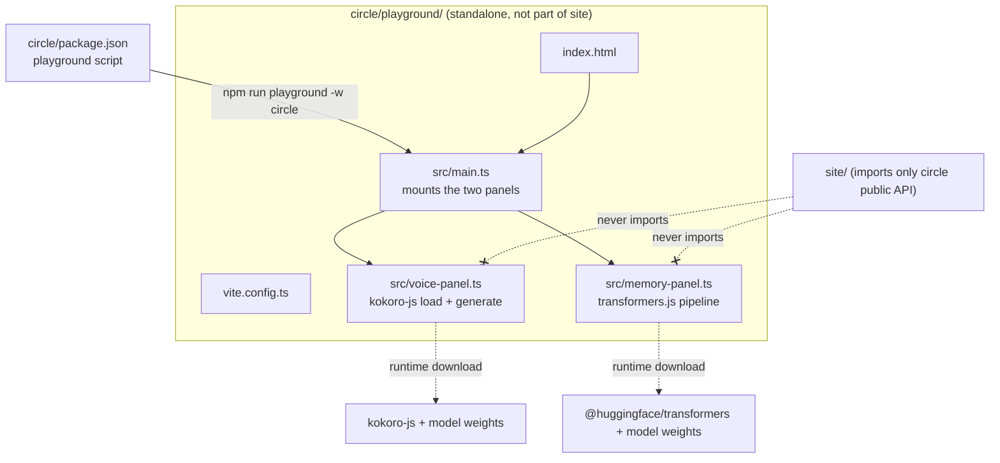
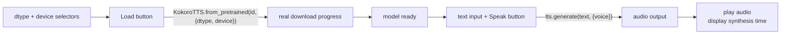

# Design Document: Voice and Memory Models

## Overview

Two of the creature's five parts are **voice** (text-to-speech) and **memory** (text embeddings for remembering the visitor). Before anyone writes the production loader code in Part 3, this task proves which real, browser-runnable models the Summoning Circle runtime should use, by loading them in a real browser and measuring them.

The deliverable is **not** the production runtime. It is a *measurement playground*: a standalone Vite page under `circle/playground/` with two panels (Voice and Memory) that load the candidate models, surface real download progress, run inference, and display timings. The user runs the playground on their laptop in Chrome and records the measured numbers into two complete, verified entries in `.kiro/steering/local-ai.md`, plus a per-tier decision and fallback for each part. The production loaders, worker protocol, and site wiring (Part 3) then build directly on what this task verifies.

The project rule above all is the no-guess rule: no guessed model IDs, library functions, or option names. Every model ID, library, version, and API used by the playground and recorded in `local-ai.md` is cited to an official source (npm README or HuggingFace model card). The verified facts used by this design are listed in [Verified sources](#verified-sources) and summarized in [Verified Models and APIs](#verified-models-and-apis). Measurement numbers are **not** specified by this document; they are produced by the user running the playground and recording what the panels and DevTools display.

### Scope

In scope:

- A standalone Vite playground page under `circle/playground/` (its own `index.html`, a TypeScript entry, and two panel modules), runnable with one command from the `circle` workspace.
- A Voice panel that loads the primary TTS model via its real library API, surfaces real download progress, synthesizes speech from typed text, plays the audio, and displays synthesis timing.
- A Memory panel that loads the primary embeddings model via its real library API, embeds three fixed sentences, computes and displays their pairwise cosine similarities, and asserts the two semantically-close sentences score closer.
- Two complete, verified entries in `.kiro/steering/local-ai.md` (one for voice, one for memory), each filling every template field with measured or verified values and no `<placeholder>` text remaining.
- A per-tier decision and fallback recorded for voice and for memory.
- An agent hook that validates, on save of `local-ai.md`, that every model entry has all template fields filled.
- Exact version pinning of the two AI libraries in `circle/package.json`.

Out of scope (Part 3): the real `circle/src/parts/voice.ts` and `memory.ts` loaders, the worker protocol, wiring into `site/`, and the `summon()` integration. These are detailed in [Constraints and Non-Goals](#constraints-and-non-goals).

## Architecture

The playground is a self-contained Vite application that lives **inside** the `circle` package but is **separate** from the `site/` app. It is a developer measurement tool, not a user-facing product surface. The `site/` app imports only from the `circle` package's public entry point (`circle/src/index.ts`); it never imports anything from `circle/playground/`. This keeps the runtime's public surface honest (the skeleton is reusable) while giving the playground freedom to load models on the main thread for measurement.

### Playground layout



File layout under `circle/playground/`:

```
circle/playground/
├── index.html          # standalone page shell, mounts the app
├── vite.config.ts      # Vite config scoped to the playground
└── src/
    ├── main.ts         # entry: creates and wires the two panels into the DOM
    ├── voice-panel.ts  # voice (TTS) panel logic
    └── memory-panel.ts # memory (embeddings) panel logic
```

### How it runs

`circle/package.json` declares a `"playground"` script that points Vite at the playground's config, so the page runs with a single command from the `circle` workspace:

```jsonc
{
  "scripts": {
    "playground": "vite --config circle/playground/vite.config.ts"
  }
}
```

Running `npm run playground -w circle` starts Vite and serves the standalone page. The playground is built and served entirely on its own; it is not imported by or bundled into the `site/` app (Requirement 1.3).

### Main-thread inference note

The playground **may** run model loading and inference on the main thread (Requirement 4.3). This is an explicit, permitted deviation for measurement purposes only: it keeps the playground small and lets the panels read timings directly. It does **not** set a precedent for the runtime. The production Part 3 loaders **shall** run all inference in a web worker per the project rules ("All inference runs in a web worker. The main thread only handles UI"). The playground's main-thread choice is recorded in the `local-ai.md` gotchas for each model so it is not copied into the production code.

## Components and Interfaces

### Voice panel (`voice-panel.ts`)

The voice panel measures the primary text-to-speech model. Its UI has: a **dtype** selector, a **device** selector, a **Load** button with a progress display, a **text** input, a **Speak** button, an audio playback element, and a timing display.

**Loading.** The Load button calls the kokoro-js API exactly as documented in the [kokoro-js npm README](https://www.npmjs.com/package/kokoro-js):

```ts
import { KokoroTTS } from "kokoro-js"; // https://www.npmjs.com/package/kokoro-js
const tts = await KokoroTTS.from_pretrained(model_id, { dtype, device });
```

The model ID is `onnx-community/Kokoro-82M-v1.0-ONNX` per the [kokoro-js npm README](https://www.npmjs.com/package/kokoro-js) usage snippet; the [Kokoro-82M ONNX model card](https://huggingface.co/onnx-community/Kokoro-82M-ONNX) lists the same Kokoro-82M ONNX build and its own usage snippet uses `onnx-community/Kokoro-82M-ONNX`. The exact ID is whichever the library loads; both are cited and the verified one is recorded in the `local-ai.md` entry.

The verified dtype options are `"fp32"`, `"fp16"`, `"q8"`, `"q4"`, `"q4f16"`, and the verified device options are `"wasm"` or `"webgpu"` (web), per the [kokoro-js npm README](https://www.npmjs.com/package/kokoro-js). That README notes that when using `device: "webgpu"`, `dtype: "fp32"` is recommended. The panel exposes these as the only selectable values; nothing else is offered.

**Real download progress.** The Load button surfaces the library's real download progress (the library's progress callback or progress values), not a simulated or time-based animation (Requirement 5.1). When the library reports a progress value, the panel displays it; when it does not, the panel displays no fabricated value. The exact progress option name is verified against the [kokoro-js npm README](https://www.npmjs.com/package/kokoro-js) during implementation and recorded in the entry's gotchas; until then it is described at the capability level per the no-guess rule.

**Synthesizing.** The Speak button synthesizes audio from the entered text using the [kokoro-js npm README](https://www.npmjs.com/package/kokoro-js) API:

```ts
const audio = await tts.generate(text, { voice });
```

Voices are listed via `tts.list_voices()`; the README's example voice is `"af_heart"` (Requirement 2.4). The panel uses a voice from that list and records the chosen voice in the entry.

**Playback and timing.** The panel plays the returned audio and displays the time taken to synthesize, measured by the playground around the `generate` call (not estimated). For a 12-word sentence the panel displays the measured synthesis time (Requirement 2.3). The exact shape of the returned audio object (sample data and sample rate) is verified against the [kokoro-js npm README](https://www.npmjs.com/package/kokoro-js) during implementation and recorded in the entry; the panel plays it through an `<audio>` element or the Web Audio API.

### Memory panel (`memory-panel.ts`)

The memory panel measures the primary embeddings model. Its UI has: a **Load** button with a progress display, an **Embed** action, and a results area showing the three fixed sentences and their pairwise cosine similarities.

**Loading.** The Load button calls the Transformers.js `pipeline('feature-extraction', ...)` API, following the feature-extraction usage documented on the [Xenova/bge-m3 model card](https://huggingface.co/Xenova/bge-m3) and confirmed by the [onnx-community/gte-multilingual-base README](https://huggingface.co/onnx-community/gte-multilingual-base):

```ts
import { pipeline } from "@huggingface/transformers"; // https://www.npmjs.com/package/@huggingface/transformers
const extractor = await pipeline("feature-extraction", "Xenova/all-MiniLM-L6-v2");
```

The model ID is `Xenova/all-MiniLM-L6-v2` per the [model card](https://huggingface.co/Xenova/all-MiniLM-L6-v2) (ONNX export of the original [sentence-transformers/all-MiniLM-L6-v2](https://huggingface.co/sentence-transformers/all-MiniLM-L6-v2)), producing 384-dimensional embeddings.

**Real download progress.** As with the voice panel, the Load button surfaces the library's real download progress, not a simulated animation (Requirement 5.1). The exact progress option name is verified against the [@huggingface/transformers npm README](https://www.npmjs.com/package/@huggingface/transformers) during implementation and recorded in the entry's gotchas.

**Embedding.** The panel embeds the three fixed sentences using the verified extraction options from the [Xenova/bge-m3 model card](https://huggingface.co/Xenova/bge-m3):

```ts
const embeddings = await extractor(texts, { pooling: "mean", normalize: true });
```

The three fixed sentences are (Requirement 3.2):

1. "I love the rain"
2. "Storms make me happy"
3. "My laptop is broken"

**Cosine similarity.** Because `normalize: true` produces unit vectors, cosine similarity is the dot product of the two vectors. The panel computes all three pairwise similarities (1↔2, 1↔3, 2↔3) and displays them. It asserts the semantic-closeness invariant (Requirement 3.3): the similarity between "I love the rain" and "Storms make me happy" is greater than the similarity between either of those and "My laptop is broken". If that invariant fails, the panel reports it visibly — it means the model is not capturing semantic closeness and is the wrong choice.

### Playground entry and Vite config

`src/main.ts` creates the two panels, appends them to the page, and wires their buttons to the panel modules. `vite.config.ts` scopes Vite to `circle/playground/` with its own `index.html` as the entry, so the playground is built and served independently of `site/`. The playground depends on `kokoro-js` and `@huggingface/transformers`, which are already pinned in `circle/package.json` (see [Version pinning](#version-pinning)); it does not add new runtime dependencies.

### local-ai.md entries and per-tier decisions

Two entries are appended to the "Verified entries" section of `.kiro/steering/local-ai.md`, one for the voice (TTS) model and one for the memory (embeddings) model, using the template at the top of that file. Each entry fills every template field — kind, library and exact version, model ID, size, tier, license, verified date and machine, a minimal working snippet, and gotchas — with measured or verified values, and no `<placeholder>` text remains (Requirement 6.2). The per-field plan appears in the local-ai.md entry design section below.

Each entry is followed by a **decision** block naming, for each of the `tiny`, `small`, and `full` tiers, the dtype and backend to use, and the fallback model if loading fails (Requirement 7.1, 7.2). The decisions list the verified dtype/backend options but are *decisions*, not measured assignments — the tier assignments are not measured by the user (Requirement 7.6).

An agent hook (the task's step 4) fires when `.kiro/steering/local-ai.md` is saved and checks that every model entry has all template fields filled, i.e. no `<placeholder>` remains. This enforces Requirement 6.2 at save time so an incomplete entry cannot slip into the repo.

## Data Models

The playground works with a small set of runtime values. The panel states are plain TypeScript; nothing here is persisted except what the library itself caches (model files in OPFS, per Requirement 11).

### Voice panel state

| Field | Type | Source |
|---|---|---|
| `dtype` | `"fp32" \| "fp16" \| "q8" \| "q4" \| "q4f16"` | verified dtype options ([kokoro-js npm README](https://www.npmjs.com/package/kokoro-js)) |
| `device` | `"wasm" \| "webgpu"` | verified device options ([kokoro-js npm README](https://www.npmjs.com/package/kokoro-js)) |
| `voice` | string from `tts.list_voices()` | [kokoro-js npm README](https://www.npmjs.com/package/kokoro-js) (example: `"af_heart"`) |
| `progress` | number or absent | the library's real progress value; absent means "not reported" — never fabricated (Requirement 5.2) |
| `synthesisTimeMs` | number | measured by the playground around `tts.generate` (not estimated) |
| `audio` | the object returned by `tts.generate` | [kokoro-js npm README](https://www.npmjs.com/package/kokoro-js); exact shape verified at implementation time and recorded in the entry |

### Memory panel data

| Field | Type | Source |
|---|---|---|
| `sentences` | fixed array of 3 strings | "I love the rain", "Storms make me happy", "My laptop is broken" (Requirement 3.2) |
| `embeddings` | array of unit vectors (384-dim for `Xenova/all-MiniLM-L6-v2`) | output of `extractor(texts, { pooling: "mean", normalize: true })` ([Xenova/bge-m3 model card](https://huggingface.co/Xenova/bge-m3)) |
| `cosineSimilarity(a, b)` | number in [-1, 1] | dot product of two unit vectors (valid because `normalize: true`) |
| `similarities` | `{ s1_s2, s1_s3, s2_s3 }` | all three pairwise cosine similarities |

### Tier and decision records

The per-tier decision reuses the `Tier` type (`tiny` \| `small` \| `full`) established by the device-sigil spec; `none` is not used here because a part that cannot run at all is a Part 3 concern, not a measurement decision. Each decision block records, per tier, a chosen `dtype` and `backend`, plus the `fallback` model id and library API. The `local-ai.md` entry template fields are listed in the local-ai.md entry design section below.

## Data Flow

### Voice panel flow



### Memory panel flow

```mermaid
flowchart LR
    load["Load button"] -->|"pipeline('feature-extraction', id)"| prog["real download progress"]
    prog --> ready["model ready"]
    ready --> embed["embed 3 fixed sentences"]
    embed -->|"extractor(texts, {pooling:'mean', normalize:true})"| vecs["unit embedding vectors"]
    vecs --> sim["pairwise dot product<br/>(cosine similarity)"]
    sim --> show["display similarities<br/>assert semantic closeness"]
```



## Correctness Properties

The playground has no pure decision function like `chooseTier`, so these are *observable invariants* the user checks by running the panels and reading the entries, rather than `fast-check` property tests.

### Property 1: Real progress, not fabricated

When the library reports a download progress value, the panel displays it; when it does not, the panel displays no value. No simulated or time-based animation is ever shown.

**Validates: Requirements 5.1, 5.2**

### Property 2: Measured, not estimated

The synthesis time and load time displayed by the panel are measured around the actual library call, never estimated. The numbers recorded in `local-ai.md` come from DevTools, never invented.

**Validates: Requirements 2.3, 6.5**

### Property 3: Semantic closeness

`sim("I love the rain", "Storms make me happy")` is greater than `sim("I love the rain", "My laptop is broken")` and greater than `sim("Storms make me happy", "My laptop is broken")`. If this fails, the panel reports it visibly — the model is the wrong choice.

**Validates: Requirements 3.3**

### Property 4: Cosine of unit vectors is the dot product

Because `normalize: true` produces unit vectors, cosine similarity is the dot product of two vectors, and every result lies in [-1, 1]. The panel computes it this way.

**Validates: Requirements 3.2**

### Property 5: No-guess

Every model ID, library, version, and API used by the playground and recorded in `local-ai.md` is cited to an official source (npm README or HuggingFace model card). No unverified identifier is named.

**Validates: Requirements 8.1, 8.2**

### Property 6: Complete entries

No `<placeholder>` text remains in either `local-ai.md` entry; every template field is filled. Enforced at save time by the agent hook.

**Validates: Requirements 6.2**

## Error Handling

- **Load failure → fallback.** If the primary model fails to load, the panel reports the failure visibly. The documented recovery path is the per-tier decision's fallback model (voice → `Xenova/speecht5_tts` via Transformers.js `pipeline('text-to-speech', ...)`; memory → `Xenova/bge-small-en-v1.5` via the same `pipeline('feature-extraction', ...)` API). The playground surfaces the error rather than silently fabricating a result.
- **No progress → no fabricated progress.** If the library reports no progress value, the panel shows nothing rather than a fake bar (Requirement 5.2). A missing progress report is not treated as zero or as completion.
- **Semantic-closeness failure → visible report.** If the memory model fails the closeness invariant (Property 3), the panel reports it — the model is the wrong choice — rather than passing silently.
- **Typed errors belong to Part 3.** This task does not introduce `CircleError` codes. The playground reports failures as visible panel state. The typed `CircleError` codes (`MODEL_LOAD_FAILED`, `OUT_OF_MEMORY`, `ABORTED`, etc.) belong to the production Part 3 loaders, where a failure to load a model is a genuine error.

## Testing Strategy

- **Manual measurement by the user.** The user runs the playground in Chrome and records the numbers from DevTools and the in-page displays; Kiro cannot measure the user's laptop (per the task). The playground displays what it can (progress, timings, backend); the user records the rest (Network/Memory tabs, offline and cross-origin-isolation checks).
- **Semantic-closeness assertion.** The memory panel asserts Property 3 at runtime and reports failure visibly, so a wrong model choice is caught during the measurement run.
- **No-placeholder hook.** The agent hook validates on save of `.kiro/steering/local-ai.md` that every entry has all template fields filled and no `<placeholder>` remains (Requirement 6.2).
- **Type checking.** `npm run typecheck -w circle` confirms the playground TypeScript compiles under strict mode.
- **Guess notes.** `planning/kiro-notes.md` records where Kiro tried to guess an API and how the steering rule stopped it (task step 5).

## Measurement Plan

Each measure below is recorded by the user running the playground in Chrome and reading DevTools; the playground displays the ones it can measure in-page (download progress, load/synthesis timings, the backend actually used), and the user records the rest from DevTools. **No numbers are specified here.** The table records *what* is measured and *where* it comes from, not the values.

| Measure | Voice | Memory | Where it comes from |
|---|---|---|---|
| Download size (first load) | size of model files fetched | size of model files fetched | Playground shows progress; user records MB from DevTools Network tab |
| First load time (click to ready) | measured around `from_pretrained` | measured around `pipeline(...)` | Playground displays it |
| Second load time (from cache) | re-load after cache | re-load after cache | Playground displays it |
| Speed | time to synthesize a 12-word sentence | milliseconds per sentence (embed all three) | Playground displays it |
| Backend actually used | WebGPU or WebAssembly | WebGPU or WebAssembly | Playground displays it; user confirms in DevTools |
| Peak memory | peak during load + inference | peak during load + inference | User records from DevTools Performance/Memory tab |
| Works offline after first load? | yes/no | yes/no | User tests with network disabled after first load |
| Needs cross-origin isolation headers? | yes/no | yes/no | User checks whether COOP/COEP are required (WebGPU / threads) |

The user also tries each model with WebGPU turned off (the library's WebAssembly option, or `chrome://flags`) so the fallback path is exercised (Requirement 9, and the task's "try each one with WebGPU turned off"). Every recorded number is measured, never estimated or invented (Requirement 6.5).

## Verified Models and APIs

Every model ID, library, version, license, backend, and dtype in this table is cited to an official source. Where a fact is not among the verified facts, it is described at the capability level (per the no-guess rule, Requirement 8.3) rather than asserted.

| Part | Role | Library (exact version) | Model ID | License | Backends | dtypes |
|---|---|---|---|---|---|---|
| Voice | primary (TTS) | [`kokoro-js@1.2.1`](https://www.npmjs.com/package/kokoro-js) | `onnx-community/Kokoro-82M-v1.0-ONNX` ([kokoro-js npm README](https://www.npmjs.com/package/kokoro-js)); also `onnx-community/Kokoro-82M-ONNX` on the [model card](https://huggingface.co/onnx-community/Kokoro-82M-ONNX) | Apache-2.0 ([kokoro-js npm README](https://www.npmjs.com/package/kokoro-js)) | `wasm`, `webgpu` ([kokoro-js npm README](https://www.npmjs.com/package/kokoro-js)) | `fp32`, `fp16`, `q8`, `q4`, `q4f16` ([kokoro-js npm README](https://www.npmjs.com/package/kokoro-js)) |
| Voice | fallback (TTS) | [`@huggingface/transformers@4.3.2`](https://www.npmjs.com/package/@huggingface/transformers) | `Xenova/speecht5_tts` ([model card](https://huggingface.co/Xenova/speecht5_tts)) | verify from model card at entry time (not in verified facts) | recorded by measurement (WebGPU or WASM) | `fp32`, `fp16`, `q8`, `q4` ([@huggingface/transformers npm README](https://www.npmjs.com/package/@huggingface/transformers)) |
| Memory | primary (embeddings) | [`@huggingface/transformers@4.3.2`](https://www.npmjs.com/package/@huggingface/transformers) | `Xenova/all-MiniLM-L6-v2` ([model card](https://huggingface.co/Xenova/all-MiniLM-L6-v2)) | Apache-2.0 ([original model card](https://huggingface.co/sentence-transformers/all-MiniLM-L6-v2)) | recorded by measurement (WebGPU or WASM) | `fp32`, `fp16`, `q8`, `q4` ([@huggingface/transformers npm README](https://www.npmjs.com/package/@huggingface/transformers)) |
| Memory | fallback (embeddings) | [`@huggingface/transformers@4.3.2`](https://www.npmjs.com/package/@huggingface/transformers) | `Xenova/bge-small-en-v1.5` ([model card](https://huggingface.co/Xenova/bge-small-en-v1.5)) | MIT ([model card](https://huggingface.co/Xenova/bge-small-en-v1.5)) | recorded by measurement (WebGPU or WASM) | `fp32`, `fp16`, `q8`, `q4` ([@huggingface/transformers npm README](https://www.npmjs.com/package/@huggingface/transformers)) |

Notes on the table:

- **Voice primary model ID.** The [kokoro-js npm README](https://www.npmjs.com/package/kokoro-js) usage snippet uses `onnx-community/Kokoro-82M-v1.0-ONNX`; the [Kokoro-82M ONNX model card](https://huggingface.co/onnx-community/Kokoro-82M-ONNX) uses `onnx-community/Kokoro-82M-ONNX`. Both refer to the same Kokoro-82M ONNX build. The exact ID is whichever the library loads, and that one is recorded in the `local-ai.md` entry (Requirement 6.3).
- **Transformers.js backends.** The verified facts state the `device`/backend options explicitly only for kokoro-js (`wasm`, `webgpu`). For the Transformers.js models, the backend actually used is *measured* at runtime (WebGPU or WebAssembly) per the [Measurement Plan](#measurement-plan); the exact device option name for Transformers.js is verified against the [@huggingface/transformers npm README](https://www.npmjs.com/package/@huggingface/transformers) when each entry is written, and the per-tier decision records the measured backend.
- **Voice fallback license.** The verified facts do not state a license for `Xenova/speecht5_tts`. It is confirmed against the [model card](https://huggingface.co/Xenova/speecht5_tts) when the decision is written; the fallback is recorded in the per-tier decision (Requirement 7.4), not as a full `local-ai.md` entry.

## Fallback Strategy

Each part has a primary model and a fallback model used if loading the primary fails. The fallback is loaded through the same library family so the failure path is a dtype/backend change or a model swap, not a new integration.

### Voice fallback

If the primary Kokoro model fails to load, the voice falls back to SpeechT5 via Transformers.js, loaded with the `pipeline('text-to-speech', ...)` API documented on the [Xenova/speecht5_tts model card](https://huggingface.co/Xenova/speecht5_tts):

```ts
import { pipeline } from "@huggingface/transformers"; // https://www.npmjs.com/package/@huggingface/transformers
const synthesizer = await pipeline("text-to-speech", "Xenova/speecht5_tts", { dtype });
```

The verified dtype options for this pipeline are `"fp32"`, `"fp16"`, `"q8"`, `"q4"` (Requirement 7.4). The fallback is recorded in the voice per-tier decision as the model to use when loading fails.

### Memory fallback

If the primary all-MiniLM-L6-v2 fails to load, the memory falls back to `Xenova/bge-small-en-v1.5` ([model card](https://huggingface.co/Xenova/bge-small-en-v1.5), MIT-licensed), loaded via the same `pipeline('feature-extraction', ...)` API as the primary, with the same extraction options (Requirement 7.5):

```ts
const extractor = await pipeline("feature-extraction", "Xenova/bge-small-en-v1.5");
const embeddings = await extractor(texts, { pooling: "mean", normalize: true });
```

`Xenova/bge-small-en-v1.5` also produces 384-dimensional embeddings, so the memory part's downstream math is unchanged across primary and fallback.

## local-ai.md entry design

Each of the two primary models gets a full entry in `.kiro/steering/local-ai.md` following the template at the top of that file. The per-field plan:

| Template field | Voice entry | Memory entry |
|---|---|---|
| `Kind` | `tts` | `embeddings` |
| `Library` | `kokoro-js@1.2.1` ([npm](https://www.npmjs.com/package/kokoro-js)) | `@huggingface/transformers@4.3.2` ([npm](https://www.npmjs.com/package/@huggingface/transformers)) |
| `Model ID` | the exact ID the library loads (`onnx-community/Kokoro-82M-v1.0-ONNX` per [kokoro-js npm README](https://www.npmjs.com/package/kokoro-js), or `onnx-community/Kokoro-82M-ONNX` per the [model card](https://huggingface.co/onnx-community/Kokoro-82M-ONNX)) | `Xenova/all-MiniLM-L6-v2` ([model card](https://huggingface.co/Xenova/all-MiniLM-L6-v2)) |
| `Size` | measured download size, MB | measured download size, MB |
| `Tier` | `full` (the primary is the full-tier voice model; smaller tiers use lighter dtypes per the decision) | `full` (the primary is the full-tier memory model; smaller tiers use lighter dtypes per the decision) |
| `License` | Apache-2.0 ([kokoro-js npm README](https://www.npmjs.com/package/kokoro-js)) | Apache-2.0 ([original model card](https://huggingface.co/sentence-transformers/all-MiniLM-L6-v2)) |
| `Verified` | date + browser/GPU the user ran it on | date + browser/GPU the user ran it on |
| `Snippet` | the smallest code that loads the model and runs one inference, from the [kokoro-js npm README](https://www.npmjs.com/package/kokoro-js) | the smallest code that loads the model and embeds one text, from the [Xenova/bge-m3 model card](https://huggingface.co/Xenova/bge-m3) |
| `Gotchas` | measured gotchas: progress option name, returned audio shape, WebGPU-recommends-fp32 note ([kokoro-js npm README](https://www.npmjs.com/package/kokoro-js)), memory spikes, slow first run, offline/cross-origin-isolation behavior, main-thread-for-measurement-only note | measured gotchas: progress option name, returned tensor shape, memory spikes, slow first run, offline/cross-origin-isolation behavior, main-thread-for-measurement-only note |

Each entry is followed by a **decision** block in this shape:

```
Decision:
  tiny:  dtype=<...>, backend=<...>
  small: dtype=<...>, backend=<...>
  full:  dtype=<...>, backend=<...>
  fallback: <fallback model id> via <library api>
```

- For **voice**, the dtypes are chosen only from the verified options `fp32`, `fp16`, `q8`, `q4`, `q4f16` and the backends only from `wasm` or `webgpu` ([kokoro-js npm README](https://www.npmjs.com/package/kokoro-js)); the fallback is `Xenova/speecht5_tts` via Transformers.js `pipeline('text-to-speech', ...)` (Requirement 7.3, 7.4).
- For **memory**, the dtypes are chosen from the verified Transformers.js options `fp32`, `fp16`, `q8`, `q4` ([@huggingface/transformers npm README](https://www.npmjs.com/package/@huggingface/transformers)) and the backend is the one measured at runtime; the fallback is `Xenova/bge-small-en-v1.5` via the same `pipeline('feature-extraction', ...)` API (Requirement 7.5).
- The per-tier decisions are *decisions* with the verified options listed, not measured assignments, since the tier assignments are not measured by the user (Requirement 7.6).

The agent hook validates on save that no `<placeholder>` remains in any entry, enforcing Requirement 6.2.

## Version pinning

The two AI libraries are pinned to exact versions in `circle/package.json` with no `^` or `~` prefix (Requirement 10.1):

- `kokoro-js` pinned to `1.2.1` ([npm](https://www.npmjs.com/package/kokoro-js), Requirement 10.2).
- `@huggingface/transformers` pinned to `4.3.2` ([npm](https://www.npmjs.com/package/@huggingface/transformers), Requirement 10.3).

When a pinned AI library version changes, the `local-ai.md` entry for that library is updated in the same change (Requirement 10.4).

## Constraints and Non-Goals

- **No production loaders.** This task does not create `circle/src/parts/voice.ts` or `circle/src/parts/memory.ts`, the worker protocol, or any `summon()` integration. Those are Part 3 and build directly on what this task verifies.
- **No site wiring.** The playground is not imported by or bundled into `site/`. The site app imports only from `circle`'s public entry point (`circle/src/index.ts`), never from `circle/playground/` (Requirement 1.3).
- **No model weights committed.** Models download at runtime and are cached in OPFS; no weights are vendored into the repo (Requirement 11).
- **Main-thread inference is playground-only.** The playground may load and infer on the main thread for measurement (Requirement 4.3). The production loaders shall run inference in a web worker; this is recorded in each entry's gotchas so it is not copied forward.
- **No invented facts.** Every model ID, library, version, and API used by the playground and recorded in `local-ai.md` is cited to an official source; where a fact is not verified it is described at the capability level (Requirement 8).
- **No invented numbers.** Measurement values are produced by the user, not specified here; the playground displays what it can and the user records the rest from DevTools.
- **kiro-notes.md.** The task's step 5 records, in `planning/kiro-notes.md`, where Kiro tried to guess an API and how the steering rule stopped it. This is a process note, not part of the runtime.

## Verified sources

- kokoro-js npm package — https://www.npmjs.com/package/kokoro-js
- Kokoro-82M ONNX HuggingFace model card — https://huggingface.co/onnx-community/Kokoro-82M-ONNX
- @huggingface/transformers npm package — https://www.npmjs.com/package/@huggingface/transformers
- Xenova/speecht5_tts HuggingFace model card — https://huggingface.co/Xenova/speecht5_tts
- Xenova/all-MiniLM-L6-v2 HuggingFace model card — https://huggingface.co/Xenova/all-MiniLM-L6-v2
- sentence-transformers/all-MiniLM-L6-v2 (license) HuggingFace model card — https://huggingface.co/sentence-transformers/all-MiniLM-L6-v2
- Xenova/bge-small-en-v1.5 HuggingFace model card — https://huggingface.co/Xenova/bge-small-en-v1.5
- Xenova/bge-m3 HuggingFace model card (feature-extraction usage) — https://huggingface.co/Xenova/bge-m3
- onnx-community/gte-multilingual-base HuggingFace README (feature-extraction pattern) — https://huggingface.co/onnx-community/gte-multilingual-base
